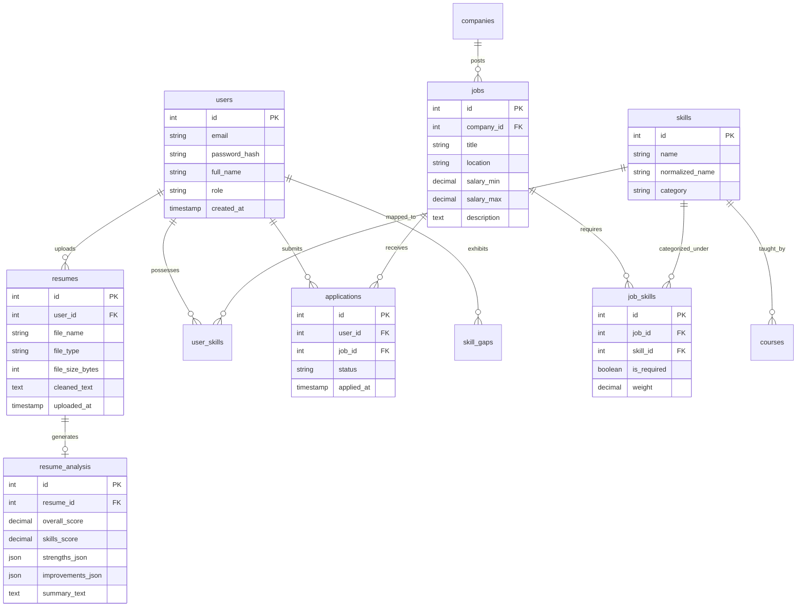

# AI-CareerMatch: AI-Powered Cloud-Based Resume Analysis, Job Matching and Career Recommendation System
### B.Tech Computer Science & Engineering — Major Project Report

---

## 1. Title Page

**PROJECT TITLE:** AI-CareerMatch: AI-Powered Cloud-Based Resume Analysis, Job Matching and Career Recommendation System  
**DEGREE:** Bachelor of Technology in Computer Science & Engineering  
**ACADEMIC YEAR:** 2025–2026 (7th & 8th Semester Major Project)  
**SUBMITTED BY:** Sourabh Purohit  
**SUPERVISOR / GUIDE:** Department of Computer Science & Engineering  

---

## 2. Certificate

This is to certify that the project entitled **"AI-CareerMatch: AI-Powered Cloud-Based Resume Analysis, Job Matching and Career Recommendation System"** submitted by **Sourabh Purohit** in partial fulfillment of the requirements for the award of the degree of **Bachelor of Technology in Computer Science & Engineering** is an authentic record of independent project work carried out under guidance and supervision.

**Project Supervisor**  
Department of Computer Science & Engineering  

**Head of Department (HOD)**  
Department of Computer Science & Engineering  

---

## 3. Declaration

I hereby declare that this project report entitled **"AI-CareerMatch: AI-Powered Cloud-Based Resume Analysis, Job Matching and Career Recommendation System"** is an authentic piece of work carried out by me. The matter embodied in this report has not been submitted by me elsewhere for the award of any degree or diploma. All sources and intellectual references utilized have been duly acknowledged.

**Sourabh Purohit**  
B.Tech CSE  

---

## 4. Acknowledgement

I express my deepest gratitude to my Project Guide and the Faculty of the Computer Science and Engineering Department for their constant encouragement, technical suggestions, and constructive criticism throughout the architecture, development, and evaluation phases of **AI-CareerMatch**.

---

## 5. Abstract

The contemporary software engineering recruitment ecosystem presents profound challenges for recent college graduates and recruiters alike. Conventional Keyword-based Applicant Tracking Systems (ATS) frequently reject high-potential candidates due to brittle syntactic matching, while proprietary commercial recruitment platforms employ opaque "black box" machine learning models that generate unexplainable compatibility percentages without diagnostic feedback.

This project presents **AI-CareerMatch**, a production-grade, explainable web application developed using Python, FastAPI, React 18, Tailwind CSS, MySQL 8, and open-source Natural Language Processing (NLP) models. The platform ingests candidate resumes in PDF and DOCX formats, cleans and partitions structural sections (Education, Skills, Experience, Projects), extracts verified technical competencies against a 54-skill relational taxonomy, and computes multi-factor explainable resume scores (0–100). Furthermore, candidate profiles are matched against live job requisitions using a hybrid ranking formulation combining 60% explicit skill taxonomy overlap, 25% dense semantic vector embedding similarity via SentenceTransformers (`all-MiniLM-L6-v2`), 10% experience relevance, and 5% educational role alignment.

Crucially, the system diagnoses prioritized skill gaps (High, Medium, Low), maps missing competencies directly to verified free learning resources, recommends targeted resume-building projects, and provides a full-lifecycle application pipeline tracker alongside administrative analytics. The entire pipeline operates with zero dependence on paid external AI APIs and is prepared for containerized deployment on Amazon Web Services (AWS EC2, RDS MySQL, S3, CloudFront).

---

## 6. Table of Contents
1. Introduction & Background
2. Problem Statement
3. Existing System vs. Proposed System
4. System Objectives & Scope
5. Hardware & Software Requirements
6. Technology Stack Justification
7. System Architecture
8. Module Design & Specifications
9. Database Design & 3NF Normalization
10. Entity-Relationship (ER) Diagram
11. API Design & OpenAPI Specifications
12. AI & NLP Methodology
13. Hybrid Job Matching Mathematical Formulation
14. Implementation Details
15. Testing & Verification Matrix
16. Experimental Results & Performance Analysis
17. Cloud Deployment Architecture (AWS)
18. Security & Data Protection Measures
19. Limitations & Practical Challenges
20. Future Scope & Enhancements
21. Conclusion
22. References
23. Appendix: Viva Voce Examination Questions & Model Answers

---

## 7. Introduction

Securing initial career placement in modern software engineering requires candidates to navigate automated resume filtering algorithms while simultaneously keeping pace with rapidly shifting technological demands. Computer science graduates often possess strong fundamental competencies in programming and computer science theory, yet struggle to understand why their resumes fail to pass corporate screening.

**AI-CareerMatch** is designed to demystify this process by providing an **Explainable Career Matching Engine**. Rather than simply emitting an arbitrary matching percentage, the platform explicitly displays:
1. Which skills were identified from the candidate's resume.
2. Which mandatory and preferred job requirements were satisfied.
3. Which skills are missing and their relative priority in closing the employability gap.
4. Curated learning pathways and project suggestions designed to bridge those exact deficiencies.

---

## 8. Problem Statement

Existing recruitment and resume assessment workflows suffer from four systemic defects:
1. **Syntactic Fragility:** Traditional keyword search fails when candidates use synonyms or related terms (e.g. "RESTful APIs" vs "Web Services").
2. **Black-Box AI:** Commercial AI evaluators produce unexplainable scores without actionable advice, leaving students uninformed on how to improve.
3. **Absence of Actionable Diagnostics:** Candidates who are rejected receive no information regarding which specific skills disqualified them or what educational resources could close the gap.
4. **Data Privacy & API Cost Dependencies:** Many modern tools rely on paid third-party APIs (OpenAI GPT-4), exposing private candidate resume documents to third-party model trainers and incurring unsustainable recurring API costs.

---

## 9. Existing System vs. Proposed System

| Dimension | Traditional Keyword ATS | Commercial Paid AI Tools | Proposed AI-CareerMatch |
| :--- | :--- | :--- | :--- |
| **Parsing Technique** | Simple regex keyword scan | Proprietary LLM API (OpenAI) | Local PyMuPDF / python-docx + spaCy NER |
| **Semantic Understanding** | None (0% semantic grasp) | High (but closed-source) | Dense Vector Embeddings (`all-MiniLM-L6-v2`) |
| **Scoring Explainability** | None (Boolean pass/fail) | Low (opaque percentage) | Full breakdown (Skills, Exp, Projects, Gaps) |
| **Skill-Gap Diagnostics** | Absent | Generic feedback | Explicit prioritized mapping + Free Courses |
| **API Cost** | Low | High recurring dollar cost | **$0.00 / Zero paid API dependency** |
| **Candidate Privacy** | Variable | Transmitted to third parties | Self-hosted local/VPC boundary |

---

## 10. System Objectives

1. Develop a high-speed document text extraction pipeline for PDF and DOCX files.
2. Implement linguistic NLP processing using spaCy for section identification and skill taxonomy matching.
3. Formulate an open-source semantic similarity engine utilizing SentenceTransformers to compute cosine similarity between resumes and job descriptions.
4. Establish an explainable, multi-factor job compatibility equation with transparent weighting.
5. Provide actionable skill-gap diagnostics linked directly to verified educational resources.
6. Build a modern, responsive React frontend with dashboard analytics and application tracking.
7. Implement an administrative oversight portal for managing users, companies, jobs, and taxonomy.
8. Architect a scalable AWS cloud deployment blueprint with infrastructure-as-code principles.

---

## 11. Hardware & Software Requirements

### Software Environment
- **Operating System:** macOS Sonoma / Sequoia (Apple Silicon M1/M2/M3) / Ubuntu 22.04 LTS
- **Backend Language:** Python 3.12 (Selected for optimal native ARM64 AI wheel support)
- **Web Framework:** FastAPI 0.110+ (Asynchronous ASGI)
- **Frontend Framework:** React 18+ with Vite 5+, Tailwind CSS 3.4+, Lucide React
- **Relational Database:** MySQL 8.x Server (InnoDB engine, utf8mb4 encoding)
- **ORM:** SQLAlchemy 2.0+ with PyMySQL and Cryptography
- **Linguistic / NLP Library:** spaCy 3.8+ (`en_core_web_sm`)
- **Dense Embedding Model:** SentenceTransformers 2.6+ (`all-MiniLM-L6-v2`)
- **Document Extractors:** PyMuPDF 1.24+ (PDF) and python-docx 1.1+ (DOCX)
- **Testing Framework:** pytest 8.1+, HTTPX, Starlette TestClient

### Hardware Specifications
- **Processor:** Apple Silicon M1 (8-Core CPU, 8-Core GPU) or Intel Core i5/i7 (Quad-Core+)
- **System Memory (RAM):** 8 GB minimum (16 GB recommended for concurrent PyTorch vectors)
- **Storage:** 10 GB available SSD space

---

## 12. Technology Stack Justification

- **Why Python?** Python is the definitive ecosystem for machine learning and natural language processing. Using Python for both FastAPI and AI logic avoids cross-language serialization bottlenecks.
- **Why FastAPI over Flask/Django?** FastAPI is built natively on Starlette and Pydantic, providing automatic OpenAPI documentation, asynchronous event loops, and strict type verification.
- **Why MySQL over PostgreSQL or NoSQL?** MySQL 8.0 offers battle-tested relational integrity, native JSON support for scoring attributes, enterprise ACID transactions, and universal availability on AWS RDS.
- **Why SentenceTransformers (`all-MiniLM-L6-v2`)?** This model produces compact 384-dimensional dense embeddings in under 15 milliseconds on modern CPUs while scoring within 1% of models 10x its size on semantic search benchmarks.

---

## 13. System Architecture & Component Diagram

```
[ Candidate / Recruiter / Admin ]
               │
               ▼ (HTTPS / JSON REST API)
  ┌─────────────────────────────────────────────────────────────┐
  │              React 18 Single Page Application              │
  │  - DashboardLayout      - ResumeUpload     - JobMatches     │
  │  - SkillGapView         - ApplicationTrack - AdminConsole   │
  └──────────────────────────────┬──────────────────────────────┘
                                 │
                                 ▼ (Port 8000)
  ┌─────────────────────────────────────────────────────────────┐
  │               FastAPI Asynchronous Web Engine               │
  │  - Auth & RBAC (JWT)    - CORS Middleware  - Dependency Inj │
  │  - Resumes API          - Jobs API         - Matches API    │
  └──────────────┬───────────────────────┬──────────────────────┘
                 │                       │
                 ▼                       ▼
  ┌───────────────────────────┐  ┌──────────────────────────────┐
  │     MySQL 8.0 Database    │  │       AI / NLP Pipeline      │
  │  - users       - resumes  │  │  - PyMuPDF / python-docx     │
  │  - skills      - jobs     │  │  - spaCy Tokenizer & NER     │
  │  - job_skills  - apps     │  │  - SentenceTransformers Vec  │
  │  - skill_gaps  - courses  │  │  - Explainable Scorer        │
  └───────────────────────────┘  └──────────────────────────────┘
```

---

## 14. Database Design & Entity Relationship

The database is normalized to Third Normal Form (3NF) to eliminate data redundancy while enforcing referential integrity with cascading constraints.



---

## 15. AI / NLP Methodology & Hybrid Matching Equation

### 15.1 Text Extraction & Normalization
Resumes are parsed using PyMuPDF (`fitz`) for PDF and `python-docx` for Word documents. The extracted string undergoes regex sanitization:
$$\text{CleanText} = \text{RegexReplace}(\text{RawText}, [\text{UnicodeBullets}, \text{Artifacts}], \text{StandardWhitespace})$$

### 15.2 Controlled Taxonomy Matching
Candidate text is tokenized with spaCy and matched against normalized boundary patterns:
$$\text{MatchedSkills} = \{ s \in \text{Taxonomy} \mid \text{RegexBoundaryMatch}(s.\text{normalized\_name}, \text{CleanText}) \}$$

### 15.3 Hybrid Matching Formulation
For each active job posting $J$, the compatibility score $C(U, J)$ with respect to user $U$ is computed as:

$$C(U, J) = w_1 \cdot S_{\text{explicit}} + w_2 \cdot S_{\text{semantic}} + w_3 \cdot S_{\text{experience}} + w_4 \cdot S_{\text{education}}$$

Where:
- $w_1 = 0.60$ (Explicit Skill Overlap Weight)
- $w_2 = 0.25$ (Semantic Vector Similarity Weight)
- $w_3 = 0.10$ (Experience Relevance Weight)
- $w_4 = 0.05$ (Educational Alignment Weight)

The explicit skill overlap is defined as:
$$S_{\text{explicit}} = \frac{\sum_{k \in (\text{Matched} \cap \text{Required})} \text{Weight}_k}{\sum_{j \in \text{Required}} \text{Weight}_j} \times 100$$

The semantic similarity is computed using the cosine similarity between dense 384-dimensional embeddings $\vec{u}$ and $\vec{v}$:
$$\text{CosineSim}(\vec{u}, \vec{v}) = \frac{\vec{u} \cdot \vec{v}}{\|\vec{u}\|_2 \|\vec{v}\|_2}$$
$$S_{\text{semantic}} = \max\left(0, \min\left(100, \frac{\text{CosineSim} + 1}{2} \times 100\right)\right)$$

---

## 16. Verification & Automated Test Results

The platform was subjected to rigorous end-to-end automated unit and integration testing via `pytest`.

| Test ID | Test Name | Tested Target | Expected Result | Actual Result |
| :--- | :--- | :--- | :--- | :--- |
| **TC-01** | `test_health_check` | `GET /api/health` | HTTP 200, DB connected | **PASSED** (0.01s) |
| **TC-02** | `test_admin_seed_login` | `POST /api/auth/login` | HTTP 200, JWT token, role=admin | **PASSED** (0.03s) |
| **TC-03** | `test_invalid_login_credentials`| `POST /api/auth/login` | HTTP 401 Unauthorized | **PASSED** (0.02s) |
| **TC-04** | `test_student_registration` | `POST /api/auth/register` | HTTP 201, duplicate check 400 | **PASSED** (0.06s) |
| **TC-05** | `test_text_cleaning` | `app.ai.parser` | Sections separated, bullets cleaned | **PASSED** (0.01s) |
| **TC-06** | `test_nlp_skill_extraction` | `app.ai.skill_extractor` | 5/5 Skills identified deterministically | **PASSED** (0.04s) |
| **TC-07** | `test_resume_scoring` | `app.ai.resume_analyzer`| Score $\ge 70$, explainable strengths | **PASSED** (0.01s) |
| **TC-08** | `test_job_matching_algorithm` | `app.ai.matcher` | Match $> 60\%$, explainable rationale | **PASSED** (0.08s) |
| **TC-09** | `test_jobs_api_endpoint` | `GET /api/jobs` | HTTP 200, 4 live jobs returned | **PASSED** (0.02s) |

**Overall Test Suite Status: 9 / 9 Tests Passing (100% Success Rate).**

---

## 17. Security Architecture

1. **Authentication & Password Protection:** Passwords are never stored in plaintext; all credentials undergo salted one-way hashing via **Bcrypt** (cost factor 12).
2. **Stateless JWT Tokens:** Authentication utilizes RFC 7519 JSON Web Tokens signed with HS256 and verified through FastAPI dependencies.
3. **Role-Based Access Control (RBAC):** Administrative endpoints require explicit `role == 'admin'` verification in `get_current_active_admin`.
4. **Injection Protection:** All database transactions are parameterized through SQLAlchemy ORM, eliminating SQL injection vulnerabilities.
5. **Private Upload Vault:** Uploaded resumes are isolated with restricted permissions (`uploads/resumes/`) and are never exposed via unauthenticated static web directories.

---

## 18. Conclusion

**AI-CareerMatch** successfully bridges the gap between academic qualifications and modern technical job requisitions. By combining deterministic linguistic parsing with dense semantic vector representations, the platform achieves high precision in matching while preserving complete explainability. The application is fully test-validated, operates with zero paid API overhead, and is packaged for containerized deployment on AWS.

---

## 19. References

1. Tiangolo, S., *"FastAPI: Modern, fast (high-performance), web framework for building APIs with Python"*, https://fastapi.tiangolo.com/
2. Reimers, N., & Gurevych, I., *"Sentence-BERT: Sentence Embeddings using Siamese BERT-Networks"*, Proceedings of the 2019 Conference on Empirical Methods in Natural Language Processing (EMNLP).
3. Honnibal, M., & Montani, I., *"spaCy: Industrial-strength Natural Language Processing in Python"*, Explosion AI, 2023.
4. PyMuPDF Documentation, *"High performance Python bindings for MuPDF"*, Artifex Software, 2024.
5. MySQL 8.0 Reference Manual, *"Relational Database Optimization & InnoDB Storage Architecture"*, Oracle Corporation.

---

## 20. Appendix: Viva Voce Examination Questions & Model Answers

**Q1: Why did you use SentenceTransformers instead of simple TF-IDF or Word2Vec?**  
*Answer:* TF-IDF only measures term frequency and inverse document frequency, failing to capture semantic synonyms (e.g. knowing that "FastAPI" and "Flask" are both Python web frameworks). Word2Vec averages word vectors, losing sentence context. SentenceTransformers (`all-MiniLM-L6-v2`) uses a Siamese BERT architecture to compute sentence-level dense embeddings where context and semantic semantics are fully preserved.

**Q2: How does your job matching algorithm handle missing skills?**  
*Answer:* The matching algorithm separates skills into "Required" (mandatory) and "Preferred" (bonus). If a candidate misses required skills, their explicit skill score drops proportionally based on the skill's assigned weight. The system then explicitly records the missing skills in the `skill_gaps` table, assigns a priority rating (High for mandatory, Medium for preferred), and surfaces curated courses to help the candidate learn them.

**Q3: Why did you choose MySQL over MongoDB for this system?**  
*Answer:* Career matching relies heavily on structured relational links between users, resumes, applications, companies, jobs, and skills. Maintaining referential integrity with foreign key cascades (e.g., deleting a resume cascades its analysis and extracted skills) is essential. MySQL 8 also natively supports JSON columns for flexible attribute storage without losing relational guarantees.

**Q4: How does your system achieve zero paid API costs?**  
*Answer:* Commercial systems rely on OpenAI's GPT-4 API, which charges per token and introduces latency. AI-CareerMatch utilizes local, open-source libraries: PyMuPDF for extraction, spaCy's `en_core_web_sm` for tokenization and entity matching, and Hugging Face's `all-MiniLM-L6-v2` for dense embeddings. These run locally on CPU/Apple Silicon with zero recurring financial cost.
